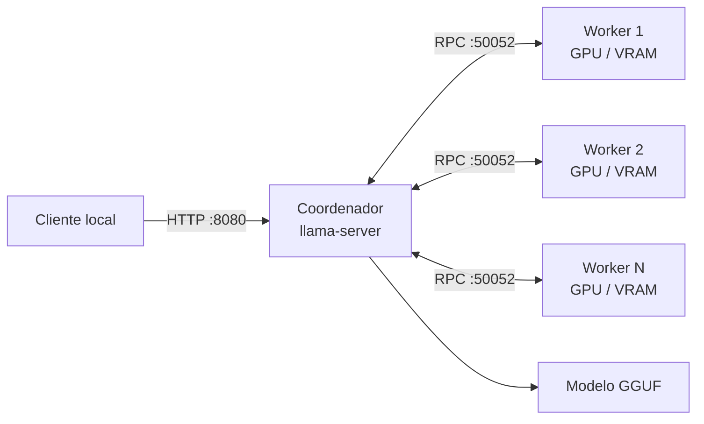

<div align="center">

# Rafão Cluster

**Transforme computadores Windows, macOS e Linux em um cluster local para inferência de LLMs com VRAM distribuída.**

[](#windows)
[](#macos)
[](#linux)
[](https://github.com/ggml-org/llama.cpp)
[](https://avaloniaui.net/)

</div>

O Rafão Cluster automatiza a configuração do RPC do
[`llama.cpp`](https://github.com/ggml-org/llama.cpp): um computador atua como
**coordenador**, enquanto os demais emprestam GPU e memória como **workers**.
Tudo é configurado por uma interface dark, sem precisar montar manualmente os
comandos de cada máquina.

> [!WARNING]
> O RPC do `llama.cpp` não deve ser exposto à internet. Use somente uma rede
> local confiável e restrinja a porta `50052` ao coordenador.

## O que já funciona

- seleção visual entre **Coordenador** e **Worker**;
- diagnóstico de GPU, VRAM/memória unificada, driver, IP e velocidade da rede;
- instalação ou atualização assistida do `llama.cpp`;
- download e seleção automática de modelos GGUF do Hugging Face;
- catálogo de modelos GGUF públicos e gratuitos, com tamanho Q4 estimado, uso indicado e licença;
- distribuição do modelo por camadas entre GPUs locais e remotas;
- teste TCP de cada worker antes de carregar o modelo;
- telemetria integrada de conexão RPC, GPU, VRAM, utilização e grafos executados;
- API compatível com OpenAI exposta apenas em `127.0.0.1` por padrão;
- configuração persistente por usuário;
- interface integralmente escura em todas as plataformas.

## Arquitetura



O coordenador mantém a API e organiza a inferência. Os workers executam o
servidor RPC e disponibilizam seus dispositivos ao backend. A velocidade final
depende principalmente das GPUs, do tamanho do modelo e da largura de banda da
rede.

## Compatibilidade

| Plataforma | Arquitetura | Aceleração | Aplicativo |
|---|---|---|---|
| Windows 10/11 | x64 | NVIDIA CUDA | WPF 0.4.6 |
| macOS 13+ | Apple Silicon arm64 | Metal | Avalonia 0.4.6 |
| Ubuntu/Debian | x64 | NVIDIA CUDA 12 ou CPU | Avalonia 0.4.6 |

> macOS Intel e Linux ARM64 ainda não possuem pacote pronto.

## Instalação

Baixe o pacote da sua plataforma na página de
**[Releases](https://github.com/renanogueira/rafao-cluster/releases)**. Os
executáveis são autocontidos e não exigem a instalação do runtime .NET.

### Windows

1. Extraia `RafaoCluster-win-x64.zip`.
2. Execute `RafaoCluster.exe`.
3. Se o Windows exibir “Editor desconhecido”, confira o hash publicado antes de
   continuar.
4. No worker, use **Configurar firewall** para criar uma regra limitada ao IP do
   coordenador.

Requisitos: Windows 10/11 x64, placa NVIDIA e driver recente.

### macOS

1. Extraia `RafaoCluster-macos-arm64.zip`.
2. Arraste `RafaoCluster.app` para **Aplicativos**.
3. Na primeira vez, clique com o botão direito no aplicativo e escolha
   **Abrir**.
4. Instale o [Homebrew](https://brew.sh/) caso ainda não esteja disponível. O
   botão **Instalar / atualizar** executará `brew install llama.cpp` e compilará
   `llama-server` e `ggml-rpc-server` com Metal e RPC habilitados. A fórmula do
   Homebrew não fornece uma compilação utilizável para o cluster distribuído.

O pacote atual possui assinatura local, mas ainda não é notarizado. Não
desative o Gatekeeper.

### Linux

```bash
sudo apt update
sudo apt install -y libx11-6 libice6 libsm6 libfontconfig1
mkdir RafaoCluster
tar -xzf RafaoCluster-linux-x64.tar.gz -C RafaoCluster
chmod +x RafaoCluster/RafaoCluster
./RafaoCluster/RafaoCluster
```

Para usar CUDA, instale primeiro um driver NVIDIA que disponibilize
`nvidia-smi`. O aplicativo detectará a GPU e baixará o pacote adequado do
`llama.cpp`.

Veja detalhes em **[Instalação por plataforma](docs/INSTALLATION.md)**.

## Primeiro cluster em cinco minutos

Supondo que os computadores estejam na rede `192.168.0.x`:

1. Reserve IPs estáveis, por exemplo coordenador `192.168.0.10` e worker
   `192.168.0.11`.
2. No worker, selecione **Worker**, informe `192.168.0.11`, mantenha a porta
   `50052`, instale o `llama.cpp` e inicie.
3. No coordenador, selecione **Coordenador** e informe
   `192.168.0.11:50052`.
4. Clique em **Baixar GGUF**, escolha um modelo pequeno para o piloto e use uma
   quantização `Q4_K_M`.
5. Mantenha contexto `4096`, API `8080` e clique em **Iniciar coordenador**.

Teste no próprio coordenador:

```bash
curl http://127.0.0.1:8080/health
curl http://127.0.0.1:8080/v1/models
```

Para incluir mais máquinas, separe os workers por vírgula:

```text
192.168.0.11:50052,192.168.0.12:50052,192.168.0.13:50052
```

O roteiro detalhado está em **[Configurando o cluster](docs/CLUSTER-GUIDE.md)**.

## Rede recomendada

| Rede | Uso recomendado |
|---|---|
| Wi-Fi | Apenas validação inicial |
| 1 GbE | Modelos pequenos e testes |
| 2.5 GbE | Mínimo recomendado para uso frequente |
| 10 GbE | Recomendado para modelos grandes e vários workers |

Prefira cabo, switch compatível e IPs estáveis. Não crie redirecionamento de
porta no roteador. Para uma instalação permanente, considere uma VLAN ou NIC
dedicada ao cluster.

## Compatibilidade RPC

Todos os computadores do cluster precisam executar exatamente a mesma revisão
do `llama.cpp`; alcançar a porta TCP não é suficiente para garantir um
handshake compatível. A versão 0.4.6 fixa Windows, macOS e Linux na build
`b12110` (commit `cd959ba`). Ao atualizar o Rafão Cluster, pare todos os
processos, clique em **Instalar / atualizar** em cada nó e só então reinicie os
workers e o coordenador.

## Compilar do código-fonte

### Windows

```powershell
winget install Microsoft.DotNet.SDK.8
Set-ExecutionPolicy -Scope Process Bypass
cd GpuClusterPilot
.\build-windows.ps1
```

### macOS e Linux

Instale o SDK .NET 10 e execute:

```bash
dotnet restore RafaoCluster.CrossPlatform/RafaoCluster.CrossPlatform.csproj
dotnet build RafaoCluster.CrossPlatform/RafaoCluster.CrossPlatform.csproj -c Release
```

Publicação autocontida:

```bash
# macOS Apple Silicon
dotnet publish RafaoCluster.CrossPlatform/RafaoCluster.CrossPlatform.csproj \
  -c Release -r osx-arm64 --self-contained true

# Linux x64
dotnet publish RafaoCluster.CrossPlatform/RafaoCluster.CrossPlatform.csproj \
  -c Release -r linux-x64 --self-contained true
```

## Estrutura do repositório

```text
.
├── GpuClusterPilot/            # Cliente Windows WPF
├── RafaoCluster.CrossPlatform/ # Cliente macOS/Linux em Avalonia
├── docs/                       # Guias operacionais e de segurança
└── .github/workflows/          # Validação automática dos três builds
```

## Documentação

- [Instalação por plataforma](docs/INSTALLATION.md)
- [Configuração do primeiro cluster](docs/CLUSTER-GUIDE.md)
- [Solução de problemas](docs/TROUBLESHOOTING.md)
- [Política e recomendações de segurança](SECURITY.md)

## Estado do projeto

Este é um projeto em evolução. Antes de usar com modelos grandes, faça o piloto
com dois nós e um GGUF pequeno. Relate problemas com sistema operacional, GPU,
VRAM, versão do driver e trecho relevante do log — nunca publique tokens do
Hugging Face.

## Créditos

Construído sobre [llama.cpp](https://github.com/ggml-org/llama.cpp),
[Avalonia UI](https://avaloniaui.net/) e
[Hugging Face Hub](https://huggingface.co/docs/hub/).

